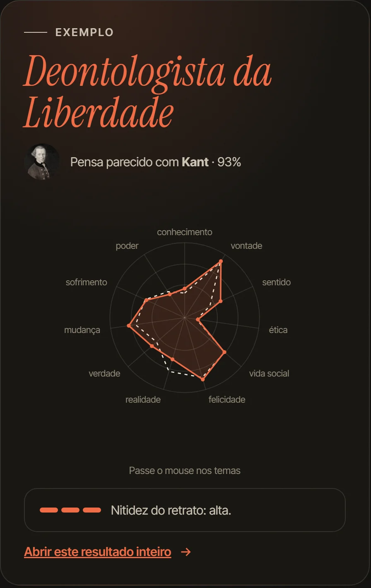

<a href="https://tiagocardosobezerra.github.io/filosofometro/"></a>

<p align="center">
  <a href="https://filosofometro.com.br/en/?utm_source=github&utm_medium=readme&utm_campaign=pagina-projeto"><strong>Take the test</strong></a> ·
  <a href="https://tiagocardosobezerra.github.io/filosofometro/"><strong>Project site</strong></a> ·
  <a href="#how-the-engine-calculates"><strong>How it calculates</strong></a> ·
  <a href="#run-locally"><strong>Run</strong></a>
</p>

<p align="center">
  <a href="README.md">Português</a> · <strong>English</strong> · <a href="README.es.md">Español</a>
</p>

<p align="center">
  
  
  
  
  
  
  
</p>

**Filosofômetro** is a free philosophy test with no sign-up. You respond to everyday statements about truth,
freedom, morality and power, and it shows you **your archetype**, **the thinker whose shape of thinking is closest to
yours** and **every number that led to it**. The calculation is open, and a second implementation, sharing no code with
the engine, checks any result.

**Live:** [filosofometro.com.br](https://filosofometro.com.br/en/?utm_source=github&utm_medium=readme&utm_campaign=pagina-projeto) · **Project site:** [tiagocardosobezerra.github.io/filosofometro](https://tiagocardosobezerra.github.io/filosofometro/)

<table>
  <tr>
    <td align="center" width="16%"><h3>132</h3><sub>statements in 3 levels: 44, 88 or 132</sub></td>
    <td align="center" width="16%"><h3>11</h3><sub>themes, each with two legitimate sides</sub></td>
    <td align="center" width="16%"><h3>180</h3><sub>thinkers: 104 in the general ranking and 76 in the regional ones</sub></td>
    <td align="center" width="16%"><h3>2</h3><sub>implementations of the calculation, sharing no code</sub></td>
    <td align="center" width="16%"><h3>208</h3><sub>automated checks on the engine and the catalog</sub></td>
    <td align="center" width="16%"><h3>0</h3><sub>sign-ups and no database of answers</sub></td>
  </tr>
</table>

## In 30 seconds

This is the sample result the site itself shows, with all 132 statements answered:

<table>
  <tr>
    <td width="40%" valign="top"></td>
    <td valign="top">

**Your archetype.** A name for your way of thinking, formed by your two strongest sides: *Deontologist of
Freedom*. There are more than 400 possible combinations.

**The closest thinker.** Kant, with 93% affinity, and the next ones in line, with the themes where you agree and
disagree.

**Face to face.** Test statement: "Lying is wrong, even to save someone." Your answer next to what the thinker would say, in
paraphrase.

**Who would disagree with you most**, your opposite in the catalog.

**Close to home.** A regional ranking: 27 Brazilians in Portuguese, 26 from the English-speaking world in English and 26
Ibero-Americans in Spanish.

**In history.** A timeline from 571 BCE to today.

**To show and discuss.** Three cards for your story, a link with a preview and the challenge: a friend takes the test and you
find out how many of the 11 themes you agree on.

**Where to start reading.** Three books by each thinker, with Amazon affiliate links.

  </td>
  </tr>
</table>


## The 11 themes

Each theme sets two legitimate answers to an old question against each other. There is no right side: the test measures
which way you lean, and how strongly.



Three levels use the same 11 themes. The more statements, the firmer the portrait:

| Level | Statements | Time | Same result when retaken |
|---|---|---|---|
| **Quick** | 44 | ~6 min | 55% of the time |
| **Complete** | 88 | ~12 min | 83% of the time |
| **Deep** | 132 | ~18 min | **94%** of the time |

## How the engine calculates

The engine is a single file, `engine.js`, with pure functions and no access to the page. The interface (`app.js`)
calculates nothing: it only shows what the engine returns.

1. Each answer is worth from +2 to −2 and is multiplied by the direction of the statement. The position on each axis is the sum of the
   contributions divided by the maximum possible (2 × the number of statements on that theme).
2. The profile is multiplied by `factor = min(3, catalog intensity ÷ your intensity)`. The same applies to each
   thinker. This way the test compares the shape of thinking, not its strength. Below intensity 0.05 the profile has no
   direction: there is no percentage and no opposite.
3. Distance is the mean of the absolute differences across the 11 axes. Affinity is
   `max(1, min(100, round(100 × e^(−(d ÷ 0.77)²))))`.
4. The ranking sorts by distance (a tie if the difference is ≤ 1e-9), then by raw distance, then by the thinker's
   id.

The `#/metodo` page explains everything for people taking the test.

## Audit

Anyone can check any result. The `#/verificar` page redoes the calculation with `verify.js`, a second
implementation written with no code in common with the engine, and compares every number.



Each result has a full audit and a JSON download (format `filosofometro-audit/2`), with all the
numbers at full precision. That file alone is enough to redo the entire ranking.

Two fingerprints appear in each audit. The **catalog** one is the FNV-1a of the `fingerprintInput` object (axes,
statements, ids, names and positions), which ships with the downloadable catalog. The **code** one covers the whole engine,
with line breaks normalized.

## Against bias

Many online quizzes end up sending almost everyone to the same few results. Here, with every change to the
catalog or the engine, three batteries check that this does not happen.

| What is checked | Result |
|---|---|
| Each thinker wins when someone answers exactly as they would | **104 of 104** |
| The most any single thinker gets, across 60 thousand simulated people | **4.2%** (limit: 6%) |
| Agreeing or disagreeing with everything | lands exactly at the center of the 11 themes |
| Inverting all answers | inverts all themes |
| Someone who thinks strongly toward one side gets a match from that side | on all **22 poles**, 65% or more |
| No favored era (Antiquity, Medieval, Modernity, Contemporary, East) | each between 0.6× and 1.5× its weight |
| The general ranking in the three languages | same ids, same order, same distances |

```bash
node tests/engine-test.js     # engine and catalog: 162 checks
node tests/reachability.js    # every thinker and every school is reachable
node tests/calibration.js     # bias by level, era, pole and language: 46 checks
```

## Three languages, three regional rankings

Besides the 104 thinkers in the general ranking, each language brings its own ranking:

| Language | Region | Thinkers | Some names |
|---|---|---|---|
| [Português](https://filosofometro.com.br/?utm_source=github&utm_medium=readme&utm_campaign=pagina-projeto) | Brazil | 27 | Paulo Freire, Lélia Gonzalez, Ailton Krenak, Nise da Silveira, Marilena Chauí, Abdias do Nascimento |
| [English](https://filosofometro.com.br/en/?utm_source=github&utm_medium=readme&utm_campaign=pagina-projeto) | English-speaking world | 26 | Mary Astell, Frederick Douglass, Jane Addams, W. E. B. Du Bois, Martha Nussbaum, bell hooks |
| [Español](https://filosofometro.com.br/es/?utm_source=github&utm_medium=readme&utm_campaign=pagina-projeto) | Ibero-America | 26 | Sor Juana Inés de la Cruz, José Martí, María Zambrano, Enrique Dussel, Gloria Anzaldúa, Jorge Luis Borges |

## Privacy

- **No sign-up:** no email, no login.
- **The calculation runs in the browser.** There is no database of answers. The result link stores only the code of the
  answers, which goes to the server only to build the preview and is not stored.
- **Cookie-free measurement** (Vercel Web Analytics). The answers code is never sent to the measurement.
- **Works offline** after the first visit, and can be installed as an app.

## Run locally

```bash
git clone https://github.com/tiagocardosobezerra/filosofometro
cd filosofometro
npx serve@14.2.4 -l 5173 .
```

Static site, no build and no database. Only the link previews use two small functions on Vercel.

## Tests

```bash
node tests/engine-test.js
```

Run it whenever you change `data.js` or `engine.js`. The battery checks the absence of bias (mirror, eras, poles, levels),
the calculation against an independent implementation, the consistency of the audit trail, whether every thinker is
reachable, stability, the distribution of results and the links.

### Reachability audit

```bash
node tests/reachability.js
```

Proves that every thinker, and therefore every school, can be the result of a real set of answers, in the main ranking
and in the Brazilian one. It does this in three ways: from the thinker's exact profile, through a search that starts from
random answers and changes one answer at a time, and through a simulation of 60 thousand people spread across all
positions. It generates `tests/reachability-report.md` with the per-thinker table.

<details>
<summary><strong>Files</strong></summary>

| File | Role |
|---|---|
| `index.html` | Page shell, metadata and fonts |
| `styles.css` | Design (light and dark theme, mobile, reduced motion) |
| `data.js` | Catalog: axes, statements and thinker positions. Data only |
| `engine.js` | Calculation engine. Pure functions, no DOM, with an audit trail |
| `verify.js` | Second implementation of the method, sharing no code with the engine. Used by the `#/verificar` page and by the tests |
| `support.js` | Support: Pix key, Amazon associate ID and two more books per thinker. Outside the catalog, does not change the fingerprint |
| `vendor/qrcode.js` | QR Code generator (Kazuhiko Arase, MIT), loaded only on the support page |
| `app.js` | Interface and routes. Calculates nothing: only shows what the engine returns |
| `tests/engine-test.js` | Test battery for the engine and the catalog |
| `docs/` | Project site on GitHub Pages ([tiagocardosobezerra.github.io/filosofometro](https://tiagocardosobezerra.github.io/filosofometro/)) |
| `assets/readme/` | Animated SVGs for this README, generated by `python -I tests/make-readme-svgs.py` from `data.js` |

</details>

<details>
<summary><strong>Link previews</strong></summary>

The app routes by hash (`#/vs/...`), which never reaches the server. That is why shared links use
`/s/<code>[/<name>]` and `/c/<a>/<b>[/<nameA>/<nameB>]`. Vercel rewrites these paths to `api/share.js`, which
returns a page with the title, description and image of the result (Open Graph) and sends the person straight to the app. The
1200 × 630 image comes from `api/og.js`: an SVG drawn with the same engine and the same colors as the site, rasterized with
`@resvg/resvg-js` and the fonts in `fonts/` (Instrument Serif and Inter Tight, OFL license). `og.png` is the site preview
without a result; to generate it again, run `node tests/make-og.js`.

</details>

<details>
<summary><strong>Installable app</strong></summary>

`manifest.webmanifest` and `sw.js` make the site installable ("Install the app" in the footer, or Add to Home Screen
on iPhone) and usable offline after the first visit. The service worker always fetches the site files from the network
first, so a new version shows up as soon as it is published; portraits and fonts are cached. It is only registered on the
published site, never on `localhost`. The icons in `icons/` come from `node tests/make-icons.js`.

</details>

<details>
<summary><strong>Support</strong></summary>

Fill in `SUPPORT` at the top of `support.js`:

- `pixKey`, `pixName` and `pixCity` enable the `#/apoie` page (QR Code and copy-and-paste Pix, built in the browser
  itself) and the "Support the project" link in the footer. With `pixKey` empty, none of this appears.
- `amazonTag` is the Amazon associate ID. Each thinker shows three books, and each one leads to a search on Amazon
  Brazil with that ID. With the ID filled in, the associate notice required by Amazon appears.

</details>

<details>
<summary><strong>Thinker pages (SEO)</strong></summary>

The app lives after the `#`, which search engines barely index. `node tests/make-pages.js` generates one static page per
thinker in `pensadores/<id>/` (biography, ideas, position on the 11 axes, three books, similar thinkers and the invitation
to take the test), the `pensadores/` index, `sitemap.xml` and `robots.txt`. Each page has a canonical address at
`https://filosofometro.com.br` and structured data (schema.org). Run it again whenever `data.js`, `support.js` or
`covers.js` change.

</details>

<details>
<summary><strong>Book covers</strong></summary>

`node tests/make-covers.js` searches Open Library for the cover of each recommended book and writes the ids to `covers.js`
(report for review in `tests/covers-report.md`; manual fixes in `OVERRIDE`). `node tests/fetch-covers.js`
downloads the covers to `covers/`, and the site serves them directly. A book without a cover shows a colored spine.

</details>

<details>
<summary><strong>Measurement</strong></summary>

Vercel Web Analytics, without cookies (enable it under Analytics in the project dashboard). The app routes and the funnel steps
arrive as readable pages: `/teste`, `/evento/teste-concluido`, `/resultado`, `/evento/story`, `/evento/convite`,
`/evento/livro`, `/evento/pix-copiado`, `/evento/app-instalado`. The answers code does not go to the measurement: it only leaves the browser when someone opens a result link, and the server uses it to build the preview without storing it.

</details>

<details>
<summary><strong>Deploy on Vercel</strong></summary>

It is a static site with two functions in `api/`: import the folder into Vercel with no framework and no build command.
`vercel.json` defines the rewrites for `/s/` and `/c/`. The `docs/` folder (project site) is left out by
`.vercelignore` and is published by GitHub Pages.

</details>

<details>
<summary><strong>Portraits</strong></summary>

The portraits come from Wikimedia Commons, linked directly from the Wikimedia server (`img` in `data.js`), with credit and a
link to the Wikipedia page (`wiki`). Licenses vary by image: old portraits are in the public domain, and
photos of contemporary people are usually CC BY or CC BY-SA. Before any commercial use, check the license of each
file on its Commons page.

Those without a freely licensed photo on Commons (Yang Zhu, Oswaldo Porchat, Carlos Nelson Coutinho, Roberto Schwarz and
Benedito Nunes) get `img: ""` and a portrait drawn from their own profile: the mandala of the 11 axes behind their
initials. The same drawing appears if an image fails to load.

</details>

## Honest limits

- **It is not a diagnosis.** It is a portrait of what you answered today, across 11 themes. It does not measure intelligence, character or
  personality.
- **The thinkers' positions are readings.** They went through a review, but they remain debatable summaries, and
  they are all in plain sight in `data.js`.
- **The Quick level is a preview.** With 44 statements, the same result comes back 55% of the time. For a firm portrait,
  take the Deep one.
- The thinkers do not endorse this test.

---

<p align="center">
  <a href="https://filosofometro.com.br/en/?utm_source=github&utm_medium=readme&utm_campaign=pagina-projeto"><strong>Know thyself: take the test</strong></a>
</p>

## Author

Made by **[Tiago Cardoso Bezerra](https://github.com/tiagocardosobezerra)** and Errantes. Also by the author: 
[Tribunal](https://github.com/tiagocardosobezerra/tribunal) (take any idea to trial),
[Vegapunk](https://github.com/tiagocardosobezerra/vegapunk), [Senku](https://github.com/tiagocardosobezerra/senku)
and [Deidara](https://github.com/tiagocardosobezerra/deidara).

Code under the MIT license ([`LICENSE`](LICENSE)). The fonts in `fonts/` are OFL, `vendor/qrcode.js` is MIT (Kazuhiko Arase) and each portrait follows the license shown on Wikimedia Commons.
