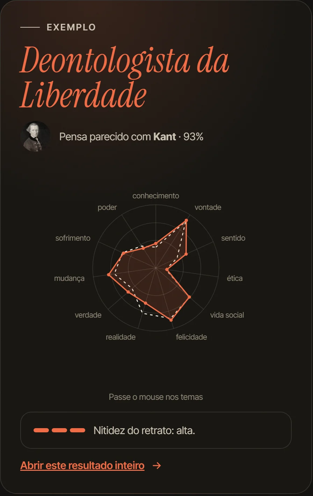

<a href="https://tiagocardosobezerra.github.io/filosofometro/"></a>

<p align="center">
  <a href="https://filosofometro.com.br/es/?utm_source=github&utm_medium=readme&utm_campaign=pagina-projeto"><strong>Hacer el test</strong></a> ·
  <a href="https://tiagocardosobezerra.github.io/filosofometro/"><strong>Sitio del proyecto</strong></a> ·
  <a href="#cómo-calcula-el-motor"><strong>Cómo calcula</strong></a> ·
  <a href="#ejecutar-en-local"><strong>Ejecutar</strong></a>
</p>

<p align="center">
  <a href="README.md">Português</a> · <a href="README.en.md">English</a> · <strong>Español</strong>
</p>

<p align="center">
  
  
  
  
  
  
  
</p>

**Filosofômetro** es un test filosófico gratuito y sin registro. Respondes afirmaciones de la vida cotidiana sobre verdad,
libertad, moral y poder, y te muestra **tu arquetipo**, **el pensador con la forma de pensar más parecida a la
tuya** y **cada número que llevó hasta él**. El cálculo es abierto, y una segunda implementación, sin código en común con el
motor, comprueba cualquier resultado.

**En línea:** [filosofometro.com.br](https://filosofometro.com.br/es/?utm_source=github&utm_medium=readme&utm_campaign=pagina-projeto) · **Sitio del proyecto:** [tiagocardosobezerra.github.io/filosofometro](https://tiagocardosobezerra.github.io/filosofometro/)

<table>
  <tr>
    <td align="center" width="16%"><h3>132</h3><sub>afirmaciones en 3 niveles: 44, 88 o 132</sub></td>
    <td align="center" width="16%"><h3>11</h3><sub>temas, cada uno con dos lados legítimos</sub></td>
    <td align="center" width="16%"><h3>180</h3><sub>pensadores: 104 en el ranking general y 76 en los regionales</sub></td>
    <td align="center" width="16%"><h3>2</h3><sub>implementaciones del cálculo, sin código en común</sub></td>
    <td align="center" width="16%"><h3>208</h3><sub>verificaciones automáticas en el motor y en el catálogo</sub></td>
    <td align="center" width="16%"><h3>0</h3><sub>registros y ninguna base de datos de respuestas</sub></td>
  </tr>
</table>

## En 30 segundos

Este es el resultado de ejemplo que muestra el propio sitio, con las 132 afirmaciones respondidas:

<table>
  <tr>
    <td width="40%" valign="top"></td>
    <td valign="top">

**Tu arquetipo.** Un nombre para tu forma de pensar, formado por tus dos lados más fuertes: *Deontologista de la
Libertad*. Hay más de 400 combinaciones posibles.

**El pensador más parecido.** Kant, con 93% de afinidad, y los siguientes de la lista, con los temas en que coinciden y
discrepan.

**Cara a cara.** Afirmación del test: "Mentir está mal, incluso para salvar a alguien." Tu respuesta junto a lo que diría el pensador, en
paráfrasis.

**Quién discreparía más de ti**, tu opuesto en el catálogo.

**Cerca de casa.** Un ranking regional: 27 brasileños en portugués, 26 del mundo de habla inglesa en inglés y 26
iberoamericanos en español.

**En la historia.** Una línea de tiempo desde 571 a. C. hasta hoy.

**Para mostrar y discutir.** Tres tarjetas para el story, un enlace con vista previa y el desafío: un amigo hace el test y
descubren en cuántos de los 11 temas coinciden.

**Por dónde empezar a leer.** Tres libros de cada pensador, con enlaces de afiliado de Amazon.

  </td>
  </tr>
</table>


## Los 11 temas

Cada tema opone dos respuestas legítimas a una pregunta antigua. No hay un lado correcto: el test mide hacia dónde
tiras, y con qué fuerza.



Tres niveles usan los mismos 11 temas. Cuantas más afirmaciones, más firme es el retrato:

| Nivel | Afirmaciones | Tiempo | Mismo resultado al repetir |
|---|---|---|---|
| **Rápido** | 44 | ~6 min | 55% de las veces |
| **Completo** | 88 | ~12 min | 83% de las veces |
| **Profundo** | 132 | ~18 min | **94%** de las veces |

## Cómo calcula el motor

El motor es un solo archivo, `engine.js`, con funciones puras y sin acceso a la página. La interfaz (`app.js`) no calcula
nada: solo muestra lo que devuelve el motor.

1. Cada respuesta vale de +2 a −2 y se multiplica por la dirección de la afirmación. La posición en cada eje es la suma de las
   contribuciones dividida entre el máximo posible (2 × el número de afirmaciones del tema).
2. El perfil se multiplica por `factor = mín(3, intensidad del catálogo ÷ tu intensidad)`. Lo mismo vale para cada
   pensador. Así el test compara la forma del pensamiento, no la fuerza. Por debajo de intensidad 0,05 el perfil no tiene
   dirección: no hay porcentaje ni opuesto.
3. La distancia es el promedio de las diferencias absolutas en los 11 ejes. La afinidad es
   `max(1, min(100, round(100 × e^(−(d ÷ 0,77)²))))`.
4. El ranking ordena por distancia (empate si la diferencia es ≤ 1e-9), luego por la distancia bruta, luego por el id del
   pensador.

La página `#/metodo` lo explica todo para quien hace el test.

## Auditoría

Cualquier persona puede comprobar cualquier resultado. La página `#/verificar` rehace la cuenta con `verify.js`, una segunda
implementación escrita sin ningún código en común con el motor, y compara cada número.



Cada resultado tiene una auditoría completa y la descarga en JSON (formato `filosofometro-audit/2`), con todos los
números en precisión completa. Ese archivo basta, por sí solo, para rehacer el ranking entero.

Dos huellas digitales aparecen en cada auditoría. La del **catálogo** es FNV-1a del objeto `fingerprintInput` (ejes,
afirmaciones, ids, nombres y posiciones), que va junto con el catálogo para descargar. La del **código** cubre el motor completo,
con los saltos de línea normalizados.

## Contra el sesgo

Muchos tests de internet terminan mandando a casi todo el mundo a los mismos pocos resultados. Aquí, con cada cambio en el
catálogo o en el motor, tres baterías comprueban que eso no ocurre.

| Qué se comprueba | Resultado |
|---|---|
| Cada pensador gana cuando alguien responde exactamente como él | **104 de 104** |
| El máximo que se lleva un pensador, en 60 mil personas simuladas | **4,2%** (límite: 6%) |
| Estar de acuerdo o en desacuerdo con todo | cae exactamente en el centro de los 11 temas |
| Invertir todas las respuestas | invierte todos los temas |
| Quien piensa con fuerza hacia un lado recibe un par de ese lado | en los **22 polos**, 65% o más |
| Ninguna época favorecida (Antigüedad, Medieval, Modernidad, Contemporáneos, Oriente) | cada una entre 0,6× y 1,5× su peso |
| El ranking general en los tres idiomas | mismos ids, mismo orden, mismas distancias |

```bash
node tests/engine-test.js     # motor y catálogo: 162 verificaciones
node tests/reachability.js    # cada pensador y cada corriente son alcanzables
node tests/calibration.js     # sesgo por nivel, época, polo e idioma: 46 verificaciones
```

## Tres idiomas, tres rankings regionales

Además de los 104 pensadores del ranking general, cada idioma trae su propio ranking:

| Idioma | Región | Pensadores | Algunos nombres |
|---|---|---|---|
| [Português](https://filosofometro.com.br/?utm_source=github&utm_medium=readme&utm_campaign=pagina-projeto) | Brasil | 27 | Paulo Freire, Lélia Gonzalez, Ailton Krenak, Nise da Silveira, Marilena Chauí, Abdias do Nascimento |
| [English](https://filosofometro.com.br/en/?utm_source=github&utm_medium=readme&utm_campaign=pagina-projeto) | Mundo de habla inglesa | 26 | Mary Astell, Frederick Douglass, Jane Addams, W. E. B. Du Bois, Martha Nussbaum, bell hooks |
| [Español](https://filosofometro.com.br/es/?utm_source=github&utm_medium=readme&utm_campaign=pagina-projeto) | Iberoamérica | 26 | Sor Juana Inés de la Cruz, José Martí, María Zambrano, Enrique Dussel, Gloria Anzaldúa, Jorge Luis Borges |

## Privacidad

- **Sin registro:** ni correo electrónico, ni inicio de sesión.
- **El cálculo se ejecuta en el navegador.** No existe una base de datos de respuestas. El enlace del resultado guarda solo el código de las
  respuestas, que va al servidor solo para armar la vista previa, sin guardarse.
- **Medición sin cookies** (Vercel Web Analytics). El código de las respuestas nunca se envía a la medición.
- **Funciona sin conexión** después de la primera visita, y se puede instalar como app.

## Ejecutar en local

```bash
git clone https://github.com/tiagocardosobezerra/filosofometro
cd filosofometro
npx serve@14.2.4 -l 5173 .
```

Sitio estático, sin build y sin base de datos. Solo las vistas previas de enlaces usan dos funciones pequeñas en Vercel.

## Pruebas

```bash
node tests/engine-test.js
```

Ejecútalo siempre que cambies `data.js` o `engine.js`. La batería comprueba la ausencia de sesgo (espejo, épocas, polos, niveles),
el cálculo frente a una implementación independiente, la coherencia del rastro de auditoría, si cada pensador es
alcanzable, la estabilidad, la distribución de los resultados y los enlaces.

### Auditoría de alcance

```bash
node tests/reachability.js
```

Demuestra que cada pensador, y por tanto cada corriente, puede ser el resultado de un conjunto real de respuestas, en el ranking
principal y en el brasileño. Lo hace de tres maneras: con el perfil exacto del pensador, con una búsqueda que parte de
respuestas aleatorias y cambia una respuesta por vez, y con una simulación de 60 mil personas repartidas por todas las
posiciones. Genera `tests/reachability-report.md` con la tabla por pensador.

<details>
<summary><strong>Archivos</strong></summary>

| Archivo | Función |
|---|---|
| `index.html` | Cascarón de la página, metadatos y fuentes |
| `styles.css` | Diseño (tema claro y oscuro, móvil, movimiento reducido) |
| `data.js` | Catálogo: ejes, afirmaciones y posiciones de los pensadores. Solo datos |
| `engine.js` | Motor de cálculo. Funciones puras, sin DOM, con rastro de auditoría |
| `verify.js` | Segunda implementación del método, sin código en común con el motor. Usada por la página `#/verificar` y por las pruebas |
| `support.js` | Apoyo: clave Pix, ID de asociado de Amazon y dos libros más por pensador. Fuera del catálogo, no cambia la huella digital |
| `vendor/qrcode.js` | Generador de código QR (Kazuhiko Arase, MIT), cargado solo en la página de apoyo |
| `app.js` | Interfaz y rutas. No calcula nada: solo muestra lo que devuelve el motor |
| `tests/engine-test.js` | Batería de pruebas del motor y del catálogo |
| `docs/` | Sitio del proyecto en GitHub Pages ([tiagocardosobezerra.github.io/filosofometro](https://tiagocardosobezerra.github.io/filosofometro/)) |
| `assets/readme/` | SVG animados de este README, generados con `python -I tests/make-readme-svgs.py` a partir de `data.js` |

</details>

<details>
<summary><strong>Vistas previas de enlaces</strong></summary>

La app enruta por el hash (`#/vs/...`), que nunca llega al servidor. Por eso los enlaces compartidos usan
`/s/<código>[/<nombre>]` y `/c/<a>/<b>[/<nombreA>/<nombreB>]`. Vercel reescribe esas rutas hacia `api/share.js`, que
devuelve una página con título, descripción e imagen del resultado (Open Graph) y envía a la persona directo a la app. La
imagen de 1200 × 630 sale de `api/og.js`: un SVG dibujado con el mismo motor y los mismos colores del sitio, rasterizado con
`@resvg/resvg-js` y las fuentes de `fonts/` (Instrument Serif e Inter Tight, licencia OFL). `og.png` es la vista previa del sitio
sin resultado; para generarla de nuevo, ejecuta `node tests/make-og.js`.

</details>

<details>
<summary><strong>App instalable</strong></summary>

`manifest.webmanifest` y `sw.js` hacen que el sitio sea instalable ("Instalar la app" en el pie, o Añadir a pantalla de inicio
en el iPhone) y utilizable sin conexión después de la primera visita. El service worker busca los archivos del sitio siempre primero en la
red, así que una nueva versión aparece en cuanto se publica; los retratos y las fuentes quedan en caché. Solo se registra en el
sitio publicado, nunca en `localhost`. Los íconos de `icons/` salen de `node tests/make-icons.js`.

</details>

<details>
<summary><strong>Apoyo</strong></summary>

Completa `SUPPORT` al inicio de `support.js`:

- `pixKey`, `pixName` y `pixCity` activan la página `#/apoie` (código QR y Pix copia y pega, armados en el propio
  navegador) y el enlace "Apoya el proyecto" en el pie. Con `pixKey` vacío, nada de eso aparece.
- `amazonTag` es el ID de asociado de Amazon. Cada pensador muestra tres libros, y cada uno lleva a una búsqueda en Amazon
  Brasil con ese ID. Con el ID completado, aparece el aviso de asociado exigido por Amazon.

</details>

<details>
<summary><strong>Páginas de los pensadores (SEO)</strong></summary>

La app vive después del `#`, que los buscadores casi no indexan. `node tests/make-pages.js` genera una página estática por
pensador en `pensadores/<id>/` (biografía, ideas, posición en los 11 ejes, tres libros, pensadores parecidos y la invitación
al test), el índice `pensadores/`, `sitemap.xml` y `robots.txt`. Cada página tiene dirección canónica en
`https://filosofometro.com.br` y datos estructurados (schema.org). Ejecútalo de nuevo siempre que cambien `data.js`, `support.js` o
`covers.js`.

</details>

<details>
<summary><strong>Portadas de los libros</strong></summary>

`node tests/make-covers.js` busca en Open Library la portada de cada libro indicado y guarda los ids en `covers.js`
(informe para revisión en `tests/covers-report.md`; correcciones manuales en `OVERRIDE`). `node tests/fetch-covers.js`
descarga las portadas en `covers/`, y el sitio las sirve directamente. Un libro sin portada muestra el lomo de color.

</details>

<details>
<summary><strong>Medición</strong></summary>

Vercel Web Analytics, sin cookies (actívalo en Analytics en el panel del proyecto). Las rutas de la app y los pasos del embudo
llegan como páginas legibles: `/teste`, `/evento/teste-concluido`, `/resultado`, `/evento/story`, `/evento/convite`,
`/evento/livro`, `/evento/pix-copiado`, `/evento/app-instalado`. El código de las respuestas no va a la medición: solo sale del navegador cuando alguien abre un enlace de resultado, y el servidor lo usa para armar la vista previa sin guardarlo.

</details>

<details>
<summary><strong>Publicar en Vercel</strong></summary>

Es un sitio estático con dos funciones en `api/`: importa la carpeta en Vercel sin framework y sin comando de build.
`vercel.json` define las reescrituras de `/s/` y `/c/`. La carpeta `docs/` (sitio del proyecto) queda fuera por el
`.vercelignore` y la publica GitHub Pages.

</details>

<details>
<summary><strong>Retratos</strong></summary>

Los retratos vienen de Wikimedia Commons, enlazados directamente desde el servidor de Wikimedia (`img` en `data.js`), con crédito y
enlace a la página de Wikipedia (`wiki`). Las licencias varían según la imagen: los retratos antiguos son de dominio público, y
las fotos de personas contemporáneas suelen ser CC BY o CC BY-SA. Antes de un uso comercial, comprueba la licencia de cada
archivo en su página de Commons.

Quien no tiene foto de licencia libre en Commons (Yang Zhu, Oswaldo Porchat, Carlos Nelson Coutinho, Roberto Schwarz y
Benedito Nunes) queda con `img: ""` y recibe un retrato dibujado por su propio perfil: la mandala de los 11 ejes detrás de las
iniciales. El mismo dibujo aparece si una imagen falla al cargar.

</details>

## Límites honestos

- **No es un diagnóstico.** Es un retrato de lo que respondiste hoy, sobre 11 temas. No mide inteligencia, carácter ni
  personalidad.
- **Las posiciones de los pensadores son lecturas.** Pasaron por una revisión, pero siguen siendo resúmenes discutibles, y
  están todas a la vista en `data.js`.
- **El nivel Rápido es una vista previa.** Con 44 afirmaciones, el mismo resultado vuelve el 55% de las veces. Para un retrato firme,
  haz el Profundo.
- Los pensadores no avalan este test.

---

<p align="center">
  <a href="https://filosofometro.com.br/es/?utm_source=github&utm_medium=readme&utm_campaign=pagina-projeto"><strong>Conócete a ti mismo: hacer el test</strong></a>
</p>

## Autor

Hecho por **[Tiago Cardoso Bezerra](https://github.com/tiagocardosobezerra)** y por Errantes. También del autor: el
[Tribunal](https://github.com/tiagocardosobezerra/tribunal) (lleva cualquier idea a juicio), el
[Vegapunk](https://github.com/tiagocardosobezerra/vegapunk), el [Senku](https://github.com/tiagocardosobezerra/senku)
y el [Deidara](https://github.com/tiagocardosobezerra/deidara).

Código bajo licencia MIT ([`LICENSE`](LICENSE)). Las fuentes de `fonts/` son OFL, `vendor/qrcode.js` es MIT (Kazuhiko Arase) y cada retrato sigue la licencia indicada en Wikimedia Commons.
