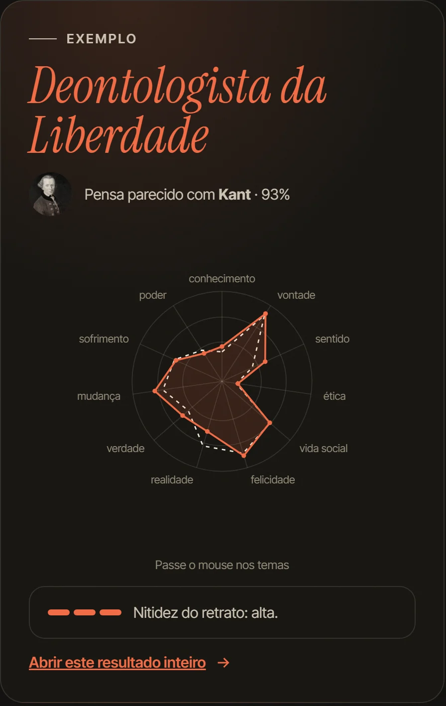

<a href="https://tiagocardosobezerra.github.io/filosofometro/"></a>

<p align="center">
  <a href="https://filosofometro.com.br/?utm_source=github&utm_medium=readme&utm_campaign=pagina-projeto"><strong>Fazer o teste</strong></a> ·
  <a href="https://tiagocardosobezerra.github.io/filosofometro/"><strong>Site do projeto</strong></a> ·
  <a href="#como-o-motor-calcula"><strong>Como calcula</strong></a> ·
  <a href="#rodar-localmente"><strong>Rodar</strong></a>
</p>

<p align="center">
  <strong>Português</strong> · <a href="README.en.md">English</a> · <a href="README.es.md">Español</a>
</p>

<p align="center">
  
  
  
  
  
  
  
</p>

O **Filosofômetro** é um teste filosófico grátis e sem cadastro. Você responde afirmações do dia a dia sobre verdade,
liberdade, moral e poder, e ele mostra **o seu arquétipo**, **o pensador com o formato de pensar mais parecido com o
seu** e **cada número que levou até ele**. O cálculo é aberto, e uma segunda implementação, sem código em comum com o
motor, confere qualquer resultado.

**No ar:** [filosofometro.com.br](https://filosofometro.com.br/?utm_source=github&utm_medium=readme&utm_campaign=pagina-projeto) · **Site do projeto:** [tiagocardosobezerra.github.io/filosofometro](https://tiagocardosobezerra.github.io/filosofometro/)

<table>
  <tr>
    <td align="center" width="16%"><h3>132</h3><sub>afirmações em 3 níveis: 44, 88 ou 132</sub></td>
    <td align="center" width="16%"><h3>11</h3><sub>temas, cada um com dois lados legítimos</sub></td>
    <td align="center" width="16%"><h3>180</h3><sub>pensadores: 104 no ranking geral e 76 nos regionais</sub></td>
    <td align="center" width="16%"><h3>2</h3><sub>implementações do cálculo, sem código em comum</sub></td>
    <td align="center" width="16%"><h3>208</h3><sub>verificações automáticas no motor e no catálogo</sub></td>
    <td align="center" width="16%"><h3>0</h3><sub>cadastros e nenhum banco de respostas</sub></td>
  </tr>
</table>

## Em 30 segundos

Este é o resultado de exemplo que o próprio site mostra, com as 132 afirmações respondidas:

<table>
  <tr>
    <td width="40%" valign="top"></td>
    <td valign="top">

**Seu arquétipo.** Um nome para o seu jeito de pensar, formado pelos seus dois lados mais fortes: *Deontologista da
Liberdade*. São mais de 400 combinações possíveis.

**O pensador mais parecido.** Kant, com 93% de afinidade, e os próximos da fila, com os temas em que vocês concordam e
discordam.

**Frente a frente.** Afirmação do teste: "Mentir é errado, mesmo para salvar alguém." A sua resposta ao lado do que o pensador diria, em
paráfrase.

**Quem mais discordaria de você**, o seu oposto no catálogo.

**Perto de casa.** Um ranking regional: 27 brasileiros em português, 26 do mundo de língua inglesa em inglês e 26
ibero-americanos em espanhol.

**Na história.** Uma linha do tempo de 571 a.C. até hoje.

**Para mostrar e discutir.** Três cards para o story, um link com prévia e o desafio: um amigo faz o teste e vocês
descobrem em quantos dos 11 temas concordam.

**Por onde começar a ler.** Três livros de cada pensador, com links de associado da Amazon.

  </td>
  </tr>
</table>


## Os 11 temas

Cada tema opõe duas respostas legítimas a uma pergunta antiga. Não existe lado certo: o teste mede para onde você
puxa, e com que força.



Três níveis usam os mesmos 11 temas. Quanto mais afirmações, mais firme o retrato:

| Nível | Afirmações | Tempo | Mesmo resultado ao refazer |
|---|---|---|---|
| **Rápido** | 44 | ~6 min | 55% das vezes |
| **Completo** | 88 | ~12 min | 83% das vezes |
| **Profundo** | 132 | ~18 min | **94%** das vezes |

## Como o motor calcula

O motor é um arquivo só, `engine.js`, com funções puras e sem acesso à página. A interface (`app.js`) não calcula
nada: só mostra o que o motor devolve.

1. Cada resposta vale de +2 a −2 e é multiplicada pela direção da afirmação. A posição em cada eixo é a soma das
   contribuições dividida pelo máximo possível (2 × o número de afirmações do tema).
2. O perfil é multiplicado por `fator = mín(3, intensidade do catálogo ÷ sua intensidade)`. O mesmo vale para cada
   pensador. Assim o teste compara o formato do pensamento, não a força. Abaixo de intensidade 0,05 o perfil não tem
   direção: não há percentual nem oposto.
3. Distância é a média das diferenças absolutas nos 11 eixos. A afinidade é
   `max(1, min(100, round(100 × e^(−(d ÷ 0,77)²))))`.
4. O ranking ordena por distância (empate se a diferença ≤ 1e-9), depois pela distância bruta, depois pelo id do
   pensador.

A página `#/metodo` explica tudo para quem faz o teste.

## Auditoria

Qualquer pessoa confere qualquer resultado. A página `#/verificar` refaz a conta com `verify.js`, uma segunda
implementação escrita sem nenhum código em comum com o motor, e compara cada número.



Cada resultado tem uma auditoria completa e o download em JSON (formato `filosofometro-audit/2`), com todos os
números em precisão completa. Esse arquivo basta, sozinho, para refazer o ranking inteiro.

Duas impressões digitais aparecem em cada auditoria. A do **catálogo** é FNV-1a do objeto `fingerprintInput` (eixos,
afirmações, ids, nomes e posições), que vai junto no catálogo para download. A do **código** cobre o motor inteiro,
com as quebras de linha normalizadas.

## Contra viés

Muito teste de internet acaba mandando quase todo mundo para os mesmos poucos resultados. Aqui, a cada mudança no
catálogo ou no motor, três baterias conferem que isso não acontece.

| O que é conferido | Resultado |
|---|---|
| Cada pensador vence quando alguém responde exatamente como ele | **104 de 104** |
| O máximo que um pensador leva, em 60 mil pessoas simuladas | **4,2%** (limite: 6%) |
| Concordar ou discordar de tudo | cai exatamente no centro dos 11 temas |
| Inverter todas as respostas | inverte todos os temas |
| Quem pensa forte para um lado recebe um par desse lado | nos **22 polos**, 65% ou mais |
| Nenhuma época favorecida (Antiguidade, Medieval, Modernidade, Contemporâneos, Oriente) | cada uma entre 0,6× e 1,5× o seu peso |
| O ranking geral nos três idiomas | mesmos ids, mesma ordem, mesmas distâncias |

```bash
node tests/engine-test.js     # motor e catálogo: 162 verificações
node tests/reachability.js    # cada pensador e cada corrente são alcançáveis
node tests/calibration.js     # viés por nível, época, polo e idioma: 46 verificações
```

## Três idiomas, três rankings regionais

Além dos 104 pensadores do ranking geral, cada idioma traz o seu próprio ranking:

| Idioma | Região | Pensadores | Alguns nomes |
|---|---|---|---|
| [Português](https://filosofometro.com.br/?utm_source=github&utm_medium=readme&utm_campaign=pagina-projeto) | Brasil | 27 | Paulo Freire, Lélia Gonzalez, Ailton Krenak, Nise da Silveira, Marilena Chauí, Abdias do Nascimento |
| [English](https://filosofometro.com.br/en/?utm_source=github&utm_medium=readme&utm_campaign=pagina-projeto) | Mundo de língua inglesa | 26 | Mary Astell, Frederick Douglass, Jane Addams, W. E. B. Du Bois, Martha Nussbaum, bell hooks |
| [Español](https://filosofometro.com.br/es/?utm_source=github&utm_medium=readme&utm_campaign=pagina-projeto) | Ibero-América | 26 | Sor Juana Inés de la Cruz, José Martí, María Zambrano, Enrique Dussel, Gloria Anzaldúa, Jorge Luis Borges |

## Privacidade

- **Sem cadastro:** nem e-mail, nem login.
- **O cálculo roda no navegador.** Não existe banco de dados de respostas. O link de resultado guarda só o código das
  respostas, que vai ao servidor apenas para montar a prévia, sem ser guardado.
- **Medição sem cookies** (Vercel Web Analytics). O código das respostas nunca é enviado para a medição.
- **Funciona offline** depois da primeira visita, e dá para instalar como app.

## Rodar localmente

```bash
git clone https://github.com/tiagocardosobezerra/filosofometro
cd filosofometro
npx serve@14.2.4 -l 5173 .
```

Site estático, sem build e sem banco de dados. Só as prévias de link usam duas funções pequenas na Vercel.

## Testes

```bash
node tests/engine-test.js
```

Rode sempre que mudar `data.js` ou `engine.js`. A bateria confere a ausência de viés (espelho, épocas, polos, níveis),
o cálculo contra uma implementação independente, a consistência da trilha de auditoria, se cada pensador é
alcançável, a estabilidade, a distribuição dos resultados e os links.

### Auditoria de alcance

```bash
node tests/reachability.js
```

Prova que cada pensador, e portanto cada corrente, pode ser o resultado de um conjunto real de respostas, no ranking
principal e no brasileiro. Faz isso de três formas: pelo perfil exato do pensador, por uma busca que parte de
respostas aleatórias e muda uma resposta por vez, e por simulação com 60 mil pessoas espalhadas por todas as
posições. Gera `tests/reachability-report.md` com a tabela por pensador.

<details>
<summary><strong>Arquivos</strong></summary>

| Arquivo | Papel |
|---|---|
| `index.html` | Casca da página, metadados e fontes |
| `styles.css` | Design (tema claro e escuro, mobile, movimento reduzido) |
| `data.js` | Catálogo: eixos, afirmações e posições dos pensadores. Só dados |
| `engine.js` | Motor de cálculo. Funções puras, sem DOM, com trilha de auditoria |
| `verify.js` | Segunda implementação do método, sem código em comum com o motor. Usada pela página `#/verificar` e pelos testes |
| `support.js` | Apoio: chave Pix, ID de associado da Amazon e mais dois livros por pensador. Fora do catálogo, não muda a impressão digital |
| `vendor/qrcode.js` | Gerador de QR Code (Kazuhiko Arase, MIT), carregado só na página de apoio |
| `app.js` | Interface e rotas. Não calcula nada: só mostra o que o motor devolve |
| `tests/engine-test.js` | Bateria de testes do motor e do catálogo |
| `docs/` | Site do projeto no GitHub Pages ([tiagocardosobezerra.github.io/filosofometro](https://tiagocardosobezerra.github.io/filosofometro/)) |
| `assets/readme/` | SVGs animados deste README, gerados por `python -I tests/make-readme-svgs.py` a partir de `data.js` |

</details>

<details>
<summary><strong>Prévias de link</strong></summary>

O app roteia pelo hash (`#/vs/...`), que nunca chega ao servidor. Por isso os links compartilhados usam
`/s/<código>[/<nome>]` e `/c/<a>/<b>[/<nomeA>/<nomeB>]`. A Vercel reescreve esses caminhos para `api/share.js`, que
devolve uma página com título, descrição e imagem do resultado (Open Graph) e manda a pessoa direto para o app. A
imagem de 1200 × 630 sai de `api/og.js`: um SVG desenhado com o mesmo motor e as mesmas cores do site, rasterizado com
`@resvg/resvg-js` e as fontes de `fonts/` (Instrument Serif e Inter Tight, licença OFL). `og.png` é a prévia do site
sem resultado; para gerar de novo, rode `node tests/make-og.js`.

</details>

<details>
<summary><strong>App instalável</strong></summary>

`manifest.webmanifest` e `sw.js` tornam o site instalável ("Instalar o app" no rodapé, ou Adicionar à Tela de Início
no iPhone) e utilizável offline depois da primeira visita. O service worker busca os arquivos do site sempre na rede
primeiro, então uma nova versão aparece assim que publicada; retratos e fontes ficam em cache. Ele só é registrado no
site publicado, nunca em `localhost`. Os ícones de `icons/` saem de `node tests/make-icons.js`.

</details>

<details>
<summary><strong>Apoio</strong></summary>

Preencha `SUPPORT` no topo de `support.js`:

- `pixKey`, `pixName` e `pixCity` ativam a página `#/apoie` (QR Code e Pix copia e cola, montados no próprio
  navegador) e o link "Apoie o projeto" no rodapé. Com `pixKey` vazio, nada disso aparece.
- `amazonTag` é o ID de associado da Amazon. Cada pensador mostra três livros, e cada um leva a uma busca na Amazon
  Brasil com esse ID. Com o ID preenchido, aparece o aviso de associado exigido pela Amazon.

</details>

<details>
<summary><strong>Páginas dos pensadores (SEO)</strong></summary>

O app vive depois do `#`, que os buscadores quase não indexam. `node tests/make-pages.js` gera uma página estática por
pensador em `pensadores/<id>/` (biografia, ideias, posição nos 11 eixos, três livros, pensadores parecidos e o convite
para o teste), o índice `pensadores/`, `sitemap.xml` e `robots.txt`. Cada página tem endereço canônico em
`https://filosofometro.com.br` e dados estruturados (schema.org). Rode de novo sempre que `data.js`, `support.js` ou
`covers.js` mudarem.

</details>

<details>
<summary><strong>Capas dos livros</strong></summary>

`node tests/make-covers.js` procura na Open Library a capa de cada livro indicado e grava os ids em `covers.js`
(relatório para revisão em `tests/covers-report.md`; correções manuais em `OVERRIDE`). `node tests/fetch-covers.js`
baixa as capas para `covers/`, e o site as serve direto. Livro sem capa mostra a lombada colorida.

</details>

<details>
<summary><strong>Medição</strong></summary>

Vercel Web Analytics, sem cookies (ative em Analytics no painel do projeto). As rotas do app e os passos do funil
chegam como páginas legíveis: `/teste`, `/evento/teste-concluido`, `/resultado`, `/evento/story`, `/evento/convite`,
`/evento/livro`, `/evento/pix-copiado`, `/evento/app-instalado`. O código das respostas não vai para a medição: ele só sai do navegador quando alguém abre um link de resultado, e o servidor usa o código para montar a prévia, sem guardá-lo.

</details>

<details>
<summary><strong>Publicar na Vercel</strong></summary>

É um site estático com duas funções em `api/`: importe a pasta na Vercel sem framework e sem comando de build.
`vercel.json` define as reescritas de `/s/` e `/c/`. A pasta `docs/` (site do projeto) fica de fora pelo
`.vercelignore` e é publicada pelo GitHub Pages.

</details>

<details>
<summary><strong>Retratos</strong></summary>

Os retratos vêm da Wikimedia Commons, linkados direto do servidor da Wikimedia (`img` em `data.js`), com crédito e
link para a página da Wikipédia (`wiki`). As licenças variam por imagem: retratos antigos são de domínio público, e
fotos de pessoas contemporâneas costumam ser CC BY ou CC BY-SA. Antes de um uso comercial, confira a licença de cada
arquivo na página dele na Commons.

Quem não tem foto de licença livre na Commons (Yang Zhu, Oswaldo Porchat, Carlos Nelson Coutinho, Roberto Schwarz e
Benedito Nunes) fica com `img: ""` e ganha um retrato desenhado pelo próprio perfil: a mandala dos 11 eixos atrás das
iniciais. O mesmo desenho aparece se uma imagem falhar ao carregar.

</details>

## Limites honestos

- **Não é diagnóstico.** É um retrato do que você respondeu hoje, sobre 11 temas. Não mede inteligência, caráter nem
  personalidade.
- **As posições dos pensadores são leituras.** Passaram por uma revisão, mas continuam sendo resumos discutíveis, e
  estão todas à vista em `data.js`.
- **O nível Rápido é uma prévia.** Com 44 afirmações, o mesmo resultado volta em 55% das vezes. Para um retrato firme,
  faça o Profundo.
- Os pensadores não endossam este teste.

---

<p align="center">
  <a href="https://filosofometro.com.br/?utm_source=github&utm_medium=readme&utm_campaign=pagina-projeto"><strong>Conhece-te a ti mesmo: fazer o teste</strong></a>
</p>

## Autor

Feito por **[Tiago Cardoso Bezerra](https://github.com/tiagocardosobezerra)** e pela Errantes. Também do autor: o
[Tribunal](https://github.com/tiagocardosobezerra/tribunal) (leve qualquer ideia a julgamento), o
[Vegapunk](https://github.com/tiagocardosobezerra/vegapunk), o [Senku](https://github.com/tiagocardosobezerra/senku)
e o [Deidara](https://github.com/tiagocardosobezerra/deidara).

Código sob licença MIT ([`LICENSE`](LICENSE)). As fontes de `fonts/` são OFL, `vendor/qrcode.js` é MIT (Kazuhiko Arase) e cada retrato segue a licença indicada na Wikimedia Commons.
